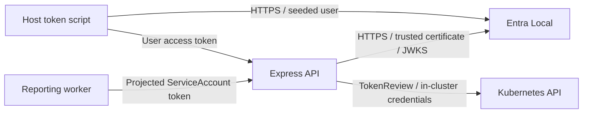

# Two identities, one API

A minimal TypeScript/Express POC: users present Entra-compatible delegated JWTs;
the reporting worker presents a Kubernetes ServiceAccount token. No real tenant,
cloud account, database, service mesh, login UI, or MSAL is needed.



## Prerequisites and start

- Docker running (Docker Desktop on macOS/Windows; Linux containers).
- `kind`, `kubectl`, Node.js LTS (22.12+; containers use Node 24), and pnpm 10.
- Available loopback ports **3000** and **8443**.
- Internet access to the package/container registries.

Run from this directory (`auth-poc/`):

```sh
pnpm install
pnpm build
pnpm test
pnpm run up
pnpm smoke
```

**Use `pnpm run up`, not `pnpm up`: pnpm reserves `up` as its built-in dependency
update alias.** The workspace provides the requested `up` script, but pnpm cannot
dispatch it without `run`. Other scripts can use their short names.

The cross-platform Node lifecycle scripts create/reuse the dedicated kind cluster
`identity-poc`, pull the official Entra Local image, build/load both applications,
deploy the manifests, export the emulator's public TLS certificate, and wait for
readiness. No Bash, hosts-file changes, host networking, or manually maintained
port-forward processes are required. Do not reuse an unrelated cluster with this
name; an existing cluster must have the port mappings created by this script.

Kubeconfig and the trusted certificate are generated under ignored `.local/`.
Commands below explicitly target this kubeconfig rather than changing your
current Kubernetes context.

## Try it

The API exposes public `GET /health`, and protected `GET /whoami` and `GET /data`.
`/data` contains three products with total quantity 25.

```sh
curl -i http://localhost:3000/whoami
# 401
pnpm --silent token
# Prints only a real RS256-signed delegated access token.
```

Copy the printed token into the Authorization header of a request to
`http://localhost:3000/whoami`, using the `Bearer` authentication scheme.
For example, in a POSIX shell:

```sh
TOKEN="$(pnpm --silent token)"
SCHEME='Bearer'
curl -H "Authorization: $SCHEME $TOKEN" http://localhost:3000/whoami
curl -H "Authorization: $SCHEME $TOKEN" http://localhost:3000/data
```

In PowerShell:

```powershell
$token = pnpm --silent token
$scheme = 'Bearer'
Invoke-RestMethod http://localhost:3000/whoami -Headers @{ Authorization = "$scheme $token" }
```

The response is a `user` principal with `provider: "entra"`, a subject, and an
optional name. The API requires the exact configured issuer/audience, a valid
RS256 signature, expiration, and delegated `access_as_user` scope. ID tokens do
not satisfy the audience/scope requirements.

### Entra Local compatibility note

We inspected the upstream [README](https://github.com/cmaneu/entra-local),
[token configuration](https://github.com/cmaneu/entra-local/blob/v0.1.1/docs/token-configuration.md),
container setup, and token-generation implementation.
Entra Local 0.1.1's existing
`POST /admin/api/apps/{appId}/token-generate` endpoint signs access tokens with
**empty `scp`** and an API-URI audience. They cannot pass delegated scope
validation; adding a scope field to that request is not supported.

Rather than weaken authentication or change upstream, `pnpm token` scripts the
emulator's supported authorization-code + PKCE flow with seeded Bob, the
`local-web-client`, and `local-api`. It captures the authorization redirect
without opening a browser or running a callback server. It requests
`api://cccccccc-0000-0000-0000-000000000007/access_as_user`, yielding the API's
GUID audience and `scp: "access_as_user"`. No real credentials are involved.

The admin generator is used directly for negative examples:

```sh
pnpm --silent token expired
pnpm --silent token invalidSignature
pnpm --silent token idToken
pnpm --silent token unscoped
```

Each prints a token rejected with 401. Admin-generated access tokens also have a
different audience and no delegated scope, so their rejection alone does not
isolate expiration/signature checking; unit tests exercise those checks using
otherwise valid claims.

### Worker and rejected Kubernetes tokens

```sh
kubectl --kubeconfig .local/kubeconfig -n identity-poc logs deployment/reporting-worker -f
```

Every 30 seconds the worker rereads its read-only projected token file, calls
both protected endpoints, and prints its `service` principal and report.
The token requests audience `urn:identity-poc:api` and a 3600-second lifetime;
Kubernetes handles projection and rotation. No default API token is mounted in
the worker and it has no RBAC bindings.

Generate test tokens with:

```sh
# Authorized worker, correct audience -> 200
kubectl --kubeconfig .local/kubeconfig -n identity-poc create token reporting-worker --audience=urn:identity-poc:api --duration=10m
# Worker, wrong audience -> 401
kubectl --kubeconfig .local/kubeconfig -n identity-poc create token reporting-worker --audience=wrong-audience --duration=10m
# Valid token, unauthorized ServiceAccount -> 403
kubectl --kubeconfig .local/kubeconfig -n identity-poc create token api --audience=urn:identity-poc:api --duration=10m
```

Use the printed value in the same Authorization header as above.
`pnpm smoke` automates all five scenarios against **both endpoints**, uses the
worker's actual projected token for the success case, checks negative Entra
variants, verifies worker reporting, and confirms the worker cannot create
TokenReviews. It needs the local cluster administrator privileges in the
generated kubeconfig to mint the negative test tokens and check RBAC.

## Networking, TLS, and the two trust models

Both services run inside kind. Docker port mappings expose only loopback
`http://localhost:3000` and `https://localhost:8443`. Worker traffic stays on
`http://api.identity-poc.svc.cluster.local:3000`.

The token issuer is exactly:

```text
https://localhost:8443/11111111-1111-1111-1111-111111111111/v2.0
```

That is an **identity string**, not an address the API tries to contact.
The API fetches JWKS separately at
`https://entra-local.identity-poc.svc.cluster.local:8443/11111111-1111-1111-1111-111111111111/discovery/v2.0/keys`.
Entra Local's `PUBLIC_ORIGIN` gives its generated certificate the internal DNS
name; its `ISSUER` sets the exact external issuer above. Its certificate also
covers `localhost`. Therefore host and Pod networking never assume that a Pod's
`localhost` is the host.

Setup exports the generated self-signed public certificate through `kubectl exec`
over the authenticated Kubernetes control channel. The API mounts it via a
ConfigMap and trusts it with `NODE_EXTRA_CA_CERTS`. Host token requests explicitly
use that certificate as their trust anchor. No TLS verification is disabled.
Entra Local calls it a CA certificate, though it is actually a self-signed
server certificate. `pnpm run up` refreshes trust and restarts the API after
redeployments; emulator data and signing keys are intentionally ephemeral.

- **Entra verification:** `jose` verifies JWTs locally with cached public JWKS
  keys, configured issuer/audience, expiration, and delegated scope. Configure
  `ENTRA_ISSUER`, `ENTRA_AUDIENCE`, and `ENTRA_JWKS_URL` to change provider details.
- **Kubernetes verification:** the API uses its in-cluster credentials and the
  Kubernetes TokenReview API with an explicit requested audience. It requires
  `authenticated: true`, the returned expected audience, and exactly
  `system:serviceaccount:identity-poc:reporting-worker`. Only the API can create
  TokenReviews. Invalid reviews, wrong audiences, and review outages fail closed
  with 401; authenticated but disallowed identities get 403.

The unverified issuer only routes to one validator. It never establishes trust;
an Entra validation failure does not fall back to Kubernetes.

## Cleanup

```sh
pnpm down
```

Deletes the **entire dedicated `identity-poc` kind cluster**, including its RBAC,
workloads, and emulator data, and removes `.local/`. Built Docker images remain
in the local image cache.

## Security limitations

**Entra Local is an intentionally insecure development emulator. Never expose it
publicly or use it for production identity validation.** Its unauthenticated admin
API can mint tokens and its seeded identities are public test data.

HTTP is acceptable only in this isolated demonstration. **Use TLS to protect
bearer tokens in production**, including worker-to-API traffic. Tokens must not
be logged, committed, or shared. The emulator's certificate and local kubeconfig
are development artifacts, not production trust infrastructure.

This POC omits rate limiting, production authorization policies, resource
isolation/network policies, high availability, and production credential
management. The API has a cluster-scoped TokenReview permission (only `create`
on `tokenreviews`); guard that identity in real deployments. A slow/unavailable
TokenReview is rejected rather than bypassed. For a real tenant, configure its
issuer, API audience, and HTTPS JWKS URL and remove emulator trust.
